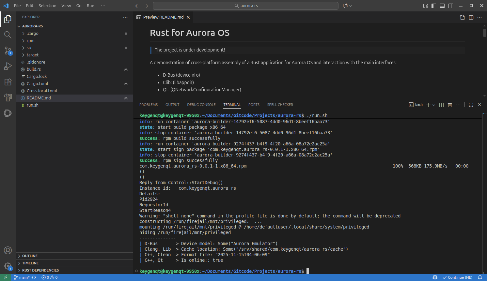

# Rust for Aurora OS

> The project is under development!

A demonstration of cross-platform assembly of a Rust application for Aurora OS and interaction with the main interfaces:

- D-Bus, (deviceinfo).
- Clib, (libappdir).
- С++, (example cxx).
- Qt, (QNetworkConfigurationManager).

### Build

- Cross: https://crates.io/crates/cross
- Aurora CLI: https://crates.io/crates/aurora-cli

### Cross.local.toml

Create it at the root of the project and customize it to suit your needs.

```toml
# armv7hl
[target.armv7-unknown-linux-gnueabihf]
env.volumes = [
    "PKG_CONFIG_SYSROOT_DIR=/home/keygenqt/.aurora-sysroot/armv7hl",
    "PKG_CONFIG_PATH=/home/keygenqt/.aurora-sysroot/armv7hl/usr/lib/pkgconfig",
    "PKG_CONFIG_LIBDIR=/home/keygenqt/.aurora-sysroot/armv7hl/usr/lib",
    "LD_LIBRARY_PATH=/home/keygenqt/.aurora-sysroot/armv7hl/usr/lib",
]

# aarch64
[target.aarch64-unknown-linux-gnu]
env.volumes = [
    "PKG_CONFIG_SYSROOT_DIR=/home/keygenqt/.aurora-sysroot/aarch64",
    "PKG_CONFIG_PATH=/home/keygenqt/.aurora-sysroot/aarch64/usr/lib/pkgconfig",
    "PKG_CONFIG_LIBDIR=/home/keygenqt/.aurora-sysroot/aarch64/usr/lib",
    "LD_LIBRARY_PATH=/home/keygenqt/.aurora-sysroot/aarch64/usr/lib",
]

# x86_64
[target.x86_64-unknown-linux-gnu]
env.volumes = [
    "PKG_CONFIG_SYSROOT_DIR=/home/keygenqt/.aurora-sysroot/x86_64",
    "PKG_CONFIG_PATH=/home/keygenqt/.aurora-sysroot/x86_64/usr/lib/pkgconfig",
    "PKG_CONFIG_LIBDIR=/home/keygenqt/.aurora-sysroot/x86_64/usr/lib",
    "LD_LIBRARY_PATH=/home/keygenqt/.aurora-sysroot/x86_64/usr/lib",
]
```

> For Windows you need to use sysroot-unix.

### Build

```shell
# armv7hl
CROSS_CONFIG="Cross.local.toml" cross build --target=armv7-unknown-linux-gnueabihf --verbose
# aarch64
CROSS_CONFIG="Cross.local.toml" cross build --target=aarch64-unknown-linux-gnu --verbose
# x86_64
CROSS_CONFIG="Cross.local.toml" cross build --target=x86_64-unknown-linux-gnu --verbose
```

### Configuration for Visual Studio Code

```json
"rust-analyzer.cargo.extraEnv": {
    "PKG_CONFIG_SYSROOT_DIR": "/Users/keygenqt/.aurora-sysroot/aarch64",
    "PKG_CONFIG_PATH": "/Users/keygenqt/.aurora-sysroot/aarch64/usr/lib/pkgconfig",
    "PKG_CONFIG_LIBDIR": "/Users/keygenqt/.aurora-sysroot/aarch64/usr/lib"
},
```

### Run on emulator

```shell
./run.sh
```

### Known issues

- ABI problem of `stdc++` and C++ libraries on aarch64 (SDK 5.2).

### Preview


